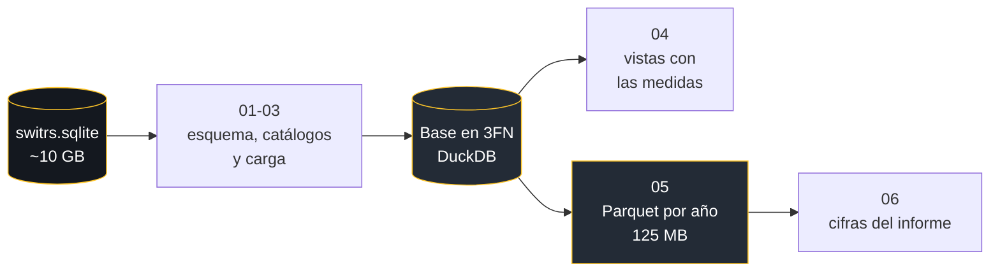

<div align="center">


<br/>

[](https://www.python.org)
[](base_de_datos)
[](#fuente-de-datos)
[](https://duckdb.org)
[](app.py)
[](#)

[Planteamiento](#planteamiento-del-problema) ·
[Objetivos](#objetivos) ·
[Tasas por habitante](#población-y-tasas-por-habitante) ·
[Lo que muestran los datos](#lo-que-muestran-los-datos) ·
[Base de datos](#la-base-de-datos) ·
[Puesta en marcha](#puesta-en-marcha) ·
[Diccionario](base_de_datos/DICCIONARIO_DE_DATOS.md) ·
[Modelado](base_de_datos/MODELADO_DE_DATOS.md)

</div>

---

Trabajo final de Computación II, Escuela de Estadística y Ciencias Actuariales de la Universidad Central de Venezuela.

Estudiamos los choques de tránsito registrados en California entre 2010 y 2019 a partir de SWITRS, el sistema en el que la California Highway Patrol reúne los partes policiales de todo el estado. Son 4.368.293 colisiones, 8.688.142 partes implicadas y 4.280.801 víctimas registradas, de las cuales 33.541 fallecieron.

## Planteamiento del problema

Las colisiones de tránsito son uno de los problemas de salud pública más graves del mundo. La Organización Mundial de la Salud estima cerca de 1,19 millones de muertes al año en las vías y las señala como la principal causa de muerte entre los 5 y los 29 años. Detrás de cada muerte hay una familia afectada, y detrás de cada colisión grave hay personas con lesiones que les cambian la vida y costos que terminan pagando los sistemas de salud.

A diferencia de muchas otras causas de muerte, las colisiones se pueden prevenir. Pero para prevenirlas primero hay que saber dónde, cuándo y en qué condiciones ocurren las más graves, y eso exige datos completos y confiables.

California tiene esos datos. Es el estado más poblado de Estados Unidos y registra cada colisión de su territorio en un mismo sistema, SWITRS, con la fecha, el lugar, las condiciones del camino, quiénes participaron y cómo quedó cada víctima. Eso nos permite estudiar el fenómeno completo, con todas las colisiones registradas en una década, y no una muestra.

### El problema

Contar choques no alcanza para entender el problema. Un mismo número puede esconder condados con tasas muy distintas, horas tranquilas y horas peligrosas, o condiciones que producen pocos choques pero de los más graves.

Entre 2010 y 2017 las colisiones en California pasaron de 416.490 a 486.432, un 16,8 % más, mientras los fallecidos pasaron de 2.739 a 3.904, un 42,5 % más. Las muertes crecieron mucho más rápido que los choques. Entender dónde, cuándo y en qué condiciones los choques son más graves es el centro de este trabajo.

### Justificación

- **Para la salud pública:** saber qué condiciones acompañan a los choques más graves ayuda a priorizar dónde intervenir.
- **Para el análisis de datos:** la fuente pesa cerca de 10 GB y viene en tablas planas con información repetida. Llevarla a una base normalizada y liviana es un problema de ingeniería de datos en sí mismo.
- **Para la estadística:** con millones de registros cualquier diferencia resulta significativa, así que el trabajo obliga a medir el tamaño de las asociaciones y no solo su existencia.

### Pregunta de investigación

> ¿Cómo se distribuyeron las colisiones de tránsito en California entre 2010 y 2019 en el tiempo y entre los condados, y qué características del conductor, de las condiciones ambientales y del vehículo se asocian con la gravedad de los choques?

## Objetivos

**Objetivo general:** analizar la distribución temporal y territorial de las colisiones de tránsito en California entre 2010 y 2019 y su asociación con características del conductor, del entorno y del vehículo.

| | Objetivo específico | Unidad de análisis |
|:---:|---|---|
| 1 | Describir los patrones temporales (año, mes, día y hora) y geográficos por condado, con conteos y tasas por 100.000 habitantes. | Colisión; condado y año |
| 2 | Comparar cómo se asocian la edad del conductor culpable y el alcohol con la gravedad del choque, y cuál de los dos pesa más. | Colisión con un conductor como culpable |
| 3 | Describir la distribución de choques según iluminación, clima y estado de la calzada, y la proporción de choques graves en cada condición. | Colisión |
| 4 | Examinar la relación entre la antigüedad del vehículo y la gravedad de las lesiones de sus ocupantes. | Víctima que viajaba en un vehículo |

## Delimitación

- **Tiempo:** del 1 de enero de 2010 al 31 de diciembre de 2019. Diez años continuos y anteriores a los cambios de movilidad de la pandemia.
- **Espacio:** los 58 condados de California.
- **Tipo de estudio:** descriptivo con un componente correlacional, no experimental y documental. Trabajamos con todos los choques registrados, no con una muestra.

## Población y tasas por habitante

**Por qué usamos tasas.** Un porcentaje dice cuánto pesa un condado dentro del total, pero no qué tan peligroso es para quien vive ahí. Los Angeles reúne el 31,6 % de las colisiones del estado, pero también es donde vive más gente. Si dividimos por la población, Los Angeles tiene 6,7 fallecidos al año por cada 100.000 habitantes y Kern, con apenas el 2,2 % de las colisiones, tiene 15,6: más del doble. Decir "15,6 de cada 100.000 personas" se entiende mejor que cualquier porcentaje del total.

```
tasa = fallecidos del condado en el año / habitantes del condado en ese año × 100.000
```

**De dónde sale la población.** SWITRS no trae población, así que usamos las [estimaciones oficiales del U.S. Census Bureau](https://www2.census.gov/programs-surveys/popest/datasets/2010-2019/counties/totals/) (*County population totals*, edición 2019), con la población de cada condado al 1 de julio de cada año entre 2010 y 2019.

**Cómo recortamos el archivo.** El original, [`co-est2019-alldata.csv`](https://www2.census.gov/programs-surveys/popest/datasets/2010-2019/counties/totals/co-est2019-alldata.csv), tiene 3.193 filas y 164 columnas: todos los condados y estados de Estados Unidos, con nacimientos, defunciones y migración. Nos quedamos con los 58 condados de California y las diez columnas de población de 2010 a 2019. Ese recorte está en `data/externa/census_co-est2019_california.csv`.

La población cuenta a quienes viven en el condado, no a quienes lo atraviesan. Por eso los condados chicos con carreteras de paso, como Alpine, quedan con tasas muy altas.

## Limitaciones de la fuente

- **La escala de lesiones cambió en 2017.** SWITRS empezó a usar códigos nuevos y desde entonces registra muchos menos ilesos. Entre 2016 y 2019 las víctimas con lesión grave suben un 23,9 % sin que eso refleje choques más graves. Para comparar años usamos solo los fallecidos.
- **El alcohol solo se marca cuando lo hubo.** Vacío quiere decir "no reportado", no "sobrio".
- **La edad del culpable falta cuando huye.** Falta en el 71,2 % de los conductores culpables que se dieron a la fuga y en el 2,2 % de los demás.
- **Las coordenadas mejoran con los años.** El 49,4 % de los choques tiene coordenadas, pero la cobertura pasa del 34,3 % en 2010 al 64,1 % en 2019. Por eso comparamos por condado.
- **No hay datos de exposición.** Sin kilómetros recorridos ni parque vehicular no podemos hablar del riesgo de chocar, solo de cómo se reparten los choques que ocurrieron.

## Lo que muestran los datos

Estas cifras salen de `base_de_datos/06_cifras.py` y están guardadas en [`resultados/cifras.json`](resultados/cifras.json). Ninguna está escrita a mano.

**Un condado concentra casi un tercio.** Los Angeles registra 1.381.690 colisiones, el 31,6 % del total. La tasa estatal subió de 7,34 a 9,46 fallecidos por cada 100.000 habitantes entre 2010 y 2019.

| Condado | Colisiones 2010-2019 |
|---|---:|
| Los Angeles | 1.381.690 |
| Orange | 334.733 |
| San Bernardino | 263.443 |
| San Diego | 253.017 |
| Riverside | 231.007 |

**El viernes es el peor día.** En promedio hubo 1.368 choques cada viernes y 973 cada domingo.

**La gravedad cambia según quién y cómo choca.** Porcentaje de colisiones con al menos un fallecido, contando solo las que tienen a un conductor como culpable:

| Grupo | Con fallecido |
|---|---:|
| Conductor culpable de 16 a 19 años | 0,50 % |
| Conductor culpable de 75 años o más | 1,09 % |
| Sin alcohol reportado | 0,43 % |
| Con alcohol reportado | 1,97 % |
| Alcance trasero | 0,17 % |
| Atropello | 3,11 % |

Son descripciones, no causas.

## La base de datos



La fuente viene en tres tablas planas con mucha información repetida. La llevamos a tercera forma normal: el núcleo son tres tablas, una por grano (`colision`, `parte` y `victima`), con dos extensiones 1:0..1 (coordenadas y datos de Caltrans), cinco tablas puente para los grupos repetidos de la fuente y 42 catálogos en español.

| Tabla | Grano | Filas |
|---|---|---:|
| `colision` | colisión | 4.368.293 |
| `colision_geo` | colisión con coordenadas | 2.159.739 |
| `colision_carretera` | colisión con datos de Caltrans | 904.581 |
| `colision_clima` · `colision_condicion_via` | condición por posición | 4.471.970 · 4.357.925 |
| `parte` | parte implicada | 8.688.142 |
| `parte_equipo_seguridad` · `parte_factor_asociado` | equipo o factor por posición | 14.175.726 · 8.370.228 |
| `victima` | víctima | 4.280.801 |
| `victima_equipo_seguridad` | equipo por posición | 7.808.349 |

Ninguna tabla guarda algo que se pueda recalcular. Fallecidos, heridos, severidad, alcohol, número de partes y calendario salen de cinco vistas: `vw_colision`, `vw_parte`, `vw_victima`, `vw_condado_anio` y `vw_calendario`. Cada decisión está explicada en el [modelado de datos](base_de_datos/MODELADO_DE_DATOS.md) y cada campo en el [diccionario](base_de_datos/DICCIONARIO_DE_DATOS.md).

## Puesta en marcha

### 1. Clonar el repositorio

```bash
git clone https://github.com/nahomiherrera1515-beep/Colisiones-California.git
```

### 2. Instalar dependencias

```bash
pip install -r requirements.txt
```

### 3. Consultar la base

La base normalizada viene incluida en `data/processed/`, así que funciona sin descargar nada más. Las vistas se cargan con `conectar_lago()` de `base_de_datos/consumo.py`.

### 4. (Opcional) Reconstruir la base desde cero

Requiere [la base original de Kaggle](https://www.kaggle.com/datasets/alexgude/california-traffic-collision-data-from-switrs) (cerca de 10 GB) en `data/raw/`. Luego, desde `base_de_datos/`, se corren en orden los scripts del `01` al `06`. Tarda unos dos minutos.

## Estructura del repositorio

```text
Colisiones-California/
├── README.md
├── requirements.txt
├── app.py                          aplicación en Streamlit
├── .streamlit/config.toml
├── Evaluacion_SQL_Formulario_G8.docx
├── assets/banner.svg
├── base_de_datos/
│   ├── configuracion.py            rutas, período y rangos válidos
│   ├── catalogos.py                catálogos escritos a mano, en español
│   ├── consumo.py                  vistas y conexión a los Parquet
│   ├── 01_creacion_esquema.py
│   ├── 02_poblacion_catalogos.py
│   ├── 03_procesamiento_carga.py
│   ├── 04_vistas_consumo.py
│   ├── 05_exportacion_parquet.py
│   ├── 06_cifras.py
│   ├── DICCIONARIO_DE_DATOS.md
│   └── MODELADO_DE_DATOS.md
├── resultados/cifras.json
└── data/
    ├── raw/                        switrs.sqlite (no se sube)
    ├── externa/                    población por condado del Census Bureau
    └── processed/                  base normalizada en Parquet, un archivo por año
```

## Fuente de datos

- Gude, A. (2021). *California traffic collision data from SWITRS* [Conjunto de datos]. Kaggle. https://www.kaggle.com/datasets/alexgude/california-traffic-collision-data-from-switrs
- California Highway Patrol. (s. f.). *Statewide Integrated Traffic Records System (SWITRS)*.
- U.S. Census Bureau. (2020). *County population totals: 2010-2019* (Vintage 2019). https://www2.census.gov/programs-surveys/popest/datasets/2010-2019/counties/totals/
- Organización Mundial de la Salud. (2023). *Informe sobre la situación mundial de la seguridad vial 2023*.

## Equipo

Nahomi Herrera, Allan Arcia, Estefani Carreño, Eddie Palomino y Alejandro Huérfano.
