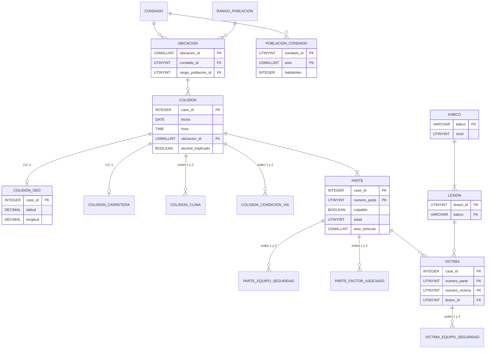

# Modelado de datos

Aquí explicamos cómo pasamos de las tres tablas planas de SWITRS a una base en tercera forma normal, y por qué tomamos cada decisión. El detalle de cada campo está en el [diccionario de datos](DICCIONARIO_DE_DATOS.md).

## 1. Punto de partida

La fuente es el archivo `switrs.sqlite` publicado por Gude (2021) en Kaggle: 9,9 GB, tres tablas (`collisions`, `parties`, `victims`) y ningún índice sobre `case_id`. Cada tabla mezcla datos propios con datos que dependen de otras columnas:

- `collisions` guarda conteos de víctimas, la severidad y banderas que se pueden recalcular desde `parties` y `victims`.
- `county_location` y `population` dependen de `county_city_location`, no del caso.
- Hay grupos repetidos (`weather_1` y `weather_2`, `party_safety_equipment_1` y `_2`...).
- Muchos códigos son texto libre en inglés sin catálogo.

Trabajamos el período del 1 de enero de 2010 al 31 de diciembre de 2019: 4.368.293 colisiones, 8.688.142 partes y 4.280.801 víctimas.

## 2. Modelo



El diagrama deja fuera los 32 catálogos de códigos para que se pueda leer. Son en total 52 tablas: 10 con datos de casos y 42 catálogos.

## 3. Decisiones de normalización

### 3.1 Nada que se pueda recalcular

Ninguna tabla guarda conteos de víctimas, severidad, número de partes, alcohol ni banderas de peatón, ciclista, motociclista o camión. Todo eso sale de las vistas (`consumo.py`). Comparamos cada medida recalculada con la columna original de la fuente y coinciden, así que guardarlas habría sido redundante.

El alcohol se nos había pasado en la primera versión. `alcohol_involved` vale 1 exactamente cuando alguna parte de la colisión había bebido (`party_sobriety` empieza con "had been drinking"), así que ahora se calcula desde el catálogo `sobriedad`, que tiene una columna `bebio`.

La única discrepancia es un caso (`case_id` 90771643) con `collision_severity = 'N'`, `party_count = 0` y `alcohol_involved = 1`, aunque tiene dos partes y ninguna había bebido. Lo tratamos como error de captura.

### 3.2 Dependencias transitivas

| Dependencia | Dónde quedó |
|---|---|
| `county_city_location` determina condado y rango de población | Tabla `ubicacion`. `colision` solo guarda `ubicacion_id`. |
| `kabco` determina `nivel` | Catálogo `kabco`. El catálogo `lesion` apunta a él y no repite el nivel. |
| `mes` determina nombre y trimestre; `dia_semana` determina nombre y fin de semana | Catálogos `mes` y `dia_semana`. El calendario es la vista `vw_calendario`. |
| `uso_celular` determina si el celular estaba en uso | Columna `en_uso` del catálogo `uso_celular`. `parte` ya no guarda `usaba_celular`. |

En la fuente cada `county_city_location` tiene un solo condado y un solo rango de población, así que la dependencia se cumple sin excepciones.

### 3.3 Grupos repetidos

Las columnas `_1` y `_2` de clima, condición de la vía, equipo de seguridad y factor asociado pasaron a cinco tablas puente con una columna `orden`. Solo hay fila cuando la fuente llenó esa posición. Si llegó un código desconocido, la fila apunta al id 0.

Así se puede contar, por ejemplo, cuántas colisiones tuvieron lluvia en cualquiera de las dos posiciones sin escribir dos condiciones.

### 3.4 Códigos de texto con catálogo

`vehicle_make`, `chp_vehicle_type_towing`, `chp_vehicle_type_towed`, `financial_responsibility`, `cellphone_use_type`, `oaf_violation_category`, la sección y el sufijo de la otra infracción, `location_type`, `side_of_highway` y `ramp_intersection` estaban guardados como texto. Ahora cada uno tiene su catálogo.

Dos catálogos se arman desde la fuente porque tienen miles de valores:

- `marca_vehiculo`: 5.193 variantes tal como las escribieron los agentes. No las unificamos; eso sería otra decisión de análisis.
- `infraccion_vehicular`: las 2.328 combinaciones de sección e inciso del código vehicular. La comparten `colision` (infracción principal) y `parte` (otra infracción).

### 3.5 Lo que parece un error y no lo es

- `carretera_estatal` no se deriva de `colision_carretera`. Hay 802.244 colisiones marcadas en carretera estatal sin bloque Caltrans. Son dos datos distintos.
- La edad y el sexo de una víctima que conducía difieren de los de su parte en cerca del 8 % de los casos. Son registros distintos del mismo parte y no los forzamos a coincidir.
- `distrito_caltrans` casi depende del condado, pero seis condados tienen tramos en dos distritos. Se queda en `colision_carretera`.
- Toda colisión con una cita del código vehicular tiene como factor primario "infracción al código vehicular". Parece que la cita determina el factor, pero hay 40.804 colisiones con ese factor y sin cita, y 224.356 sin cita con otros factores. Cuando no hay cita, el factor es el único dato, así que los dos se quedan.
- `rampa_interseccion` determina `tipo_ubicacion` cuando existe (una rampa es siempre de tipo rampa), pero el 78 % de las filas no tiene rampa y ahí `tipo_ubicacion` es el único dato. Quitarlo perdería información, así que se quedan los dos. En los datos nunca se contradicen.

## 4. Tipos y rangos

- `case_id` es INTEGER (4 bytes) en vez de texto en las diez tablas que lo repiten.
- Fechas como DATE y horas como TIME. Una hora que no se puede leer queda NULL.
- Ids de catálogo, edades y número de parte como UTINYINT; año del vehículo, ubicación, marca y cita como USMALLINT.
- Coordenadas como DECIMAL(8,5), porque la fuente trae como máximo cinco decimales. Un DOUBLE aparentaría una precisión que no existe.
- Edades fuera de 0-110 y años de vehículo fuera de 1900-2020 quedan NULL con una bandera `_en_cuarentena`. La fila se conserva.
- `materiales_peligrosos` y `relacion_bus_escolar` son TRUE o NULL, igual que en la fuente, y lo mismo `alcohol_implicado` en las vistas. Un NULL ahí quiere decir que no se reportó, no que no ocurrió.

## 5. Llaves no declaradas

En DuckDB cada PRIMARY KEY o FOREIGN KEY crea un índice ART. Con millones de filas esos índices ocupan varias veces lo que ocupan los datos y no aceleran nada: las consultas analíticas recorren columnas completas.

Por eso:

- Los catálogos, que tienen a lo sumo unos miles de filas, declaran PK, UNIQUE y FK.
- Las diez tablas con datos de casos documentan sus llaves en comentarios y en el diccionario. Las revisamos sobre los datos cargados: ninguna PK se repite y ninguna FK queda huérfana.

## 6. Escala KABCO

La escala de lesiones de SWITRS cambió en 2017. Aparecieron códigos nuevos (`suspected serious injury`, `suspected minor injury`, `possible injury`) que conviven con los anteriores hasta 2019, y desde entonces se registran muchos menos ilesos. Homologamos todos los códigos a KABCO, pero no decimos que la escala sea continua:

- Cada código tiene en el catálogo los años en que se observa (`observado_desde`, `observado_hasta`). Esos años salen de los propios datos.
- Entre 2016 y 2019 la categoría A sube un 23,9 % y los ilesos bajan un 67,2 %. Para comparar años usamos los fallecidos (K).

## 7. De la base a Parquet

`05_exportacion_parquet.py` escribe cada tabla con datos de casos en un archivo por año, ordenado por su llave y comprimido con ZSTD. Los catálogos van en `data/processed/catalogos/`. El resultado son 142 archivos y unos 130 MB, frente a los 9,9 GB de la fuente; el archivo más grande no llega a 6 MB.

Para consultar los Parquet con las mismas vistas que la base:

```python
import sys
sys.path.append("base_de_datos")

from consumo import conectar_lago

con = conectar_lago()
con.sql("""
    SELECT anio, COUNT(*) AS colisiones, SUM(fallecidos) AS fallecidos
    FROM vw_colision
    GROUP BY anio
    ORDER BY anio
""").show()
```

Power BI puede leer las mismas carpetas con el conector de Parquet y reproducir las relaciones del diagrama.

## 8. Del modelo a los objetivos

Cada objetivo del planteamiento tiene su vista y sus columnas listas, sin tener que unir tablas a mano.

| Objetivo | Vista | Universo | Columnas |
|---|---|---|---|
| 1. Patrones temporales y por condado | `vw_colision`, `vw_condado_anio` | Todas las colisiones | `anio`, `mes`, `dia_semana`, `hora_del_dia`, `condado_id`; `colisiones_por_100k` y `fallecidos_por_100k` |
| 2. Edad del conductor culpable y alcohol frente a la gravedad | `vw_colision` | `hay_conductor_culpable`, con y sin `hubo_fuga` | `banda_edad_conductor_culpable_id`, `conductor_culpable_bebio`, `alcohol_implicado` frente a `severidad`, `con_fallecido` y `es_grave` |
| 3. Iluminación, clima y superficie | `vw_colision` | Todas las colisiones | `iluminacion_id`, `clima_id`, `superficie_id` y sus marcas `es_oscuridad`, `es_adverso` y `es_adversa` frente a `es_grave` |
| 4. Antigüedad del vehículo y lesiones de sus ocupantes | `vw_victima` | `es_ocupante` | `edad_vehiculo` frente a `kabco` y `nivel_lesion` |

Dos cuidados que vienen de los datos y no del modelo. Para comparar años usamos `con_fallecido`, porque `es_grave` incluye la categoría A, que cambió en 2017. Y en el objetivo 4 no hay datos de exposición, así que medimos cómo se reparten las lesiones, no el riesgo.
